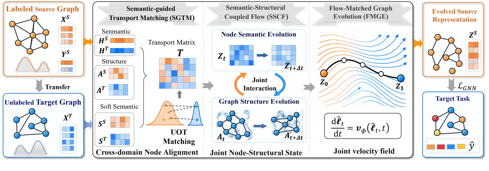

# DiffGDA++: Learning Adaptive Evolution Trajectories for Graph Domain Adaptation

This repository contains the source code for **DiffGDA++: Learning Adaptive Evolution Trajectories for Graph Domain Adaptation**.

## Abstract

Graph domain adaptation (GDA) aims to transfer knowledge from a labeled source graph to an unlabeled target graph, where large differences in feature distributions and graph structures often lead to substantial domain gaps. Existing methods mainly bridge these gaps through discrete graph alignment or stepwise adaptation. However, these approaches make adjustments at fixed steps, making it difficult to faithfully approximate the underlying transformation process of graph semantics and topology. To better capture this process, we first proposed DiffGDA, a continuous-time diffusion framework for GDA, which models the evolution of node attributes and graph structure across domains to facilitate knowledge transfer. Despite its effectiveness, DiffGDA relies on a fixed forward perturbation process and predefined stochastic dynamics to guide graph evolution, limiting its flexibility in adapting to diverse domain shifts and sample-specific variations while causing considerable computational overhead due to multi-step sampling. To address these limitations, we further propose DiffGDA++, an adaptive continuous transport framework for GDA. DiffGDA++ learns data-driven transport trajectories that adapt the evolution of graph representations to different domain shifts. It jointly models cross-domain correspondences and the coupled evolution of graph semantics and topology, supporting flexible knowledge transfer while maintaining consistency between semantic information and relational structures. Specifically, semantic-guided unbalanced optimal transport establishes reliable cross-domain correspondences under distributional mismatch, while conditional flow matching learns adaptive continuous dynamics for the joint evolution of graph semantics and topology. This design avoids repeated stochastic reverse sampling, offering a more efficient approach to continuous graph domain adaptation. Extensive experiments across five graph benchmark families demonstrate that DiffGDA++ achieves strong overall performance compared with existing GDA methods, with notable advantages on structurally complex domains, including molecular graphs and three-dimensional point-cloud graphs.

## Model Architecture



DiffGDA++ adaptively models the joint evolution of graph semantics and structure through a continuous transfer process. This design maintains semantic–structural consistency, supports flexible and efficient knowledge transfer, and produces an evolved graph for downstream tasks.

## Requirements

The reference environment uses the following:

- Python 3.10
- PyTorch 2.6.0 (CUDA 12.4)
- `torch-geometric==2.8.1`
- `faiss-cpu==1.9.0.post1`
- `numpy<2`
- `scipy<1.14`

Install PyTorch and its matching PyG extensions first, then install the remaining dependencies listed in [requirements.txt](requirements.txt):

```bash
python -m pip install -r requirements.txt
```

Bundled propagation and dataset readers are from [PyGDA](https://github.com/pygda-team/pygda).

## Method and code map

| File | Responsibility |
|---|---|
| `run.py` | One independent training run; no scheduler or hyperparameter search |
| `model/diffgda_pp.py` | Dense PP training, prediction, artifacts and replay |
| `model/pp_training.py` | Encoder feedback training and RBF MMD |
| `model/pp_components.py` | Shared encoder and node-flow components |
| `model/sct.py`, `model/transport.py` | Semantic refinement and unbalanced transport |
| `model/joint_graph.py` | Candidate support, joint/uncoupled velocities, graph head and Heun solver |
| `model/molecular_graph_pp.py` | Molecule-level transport and within-molecule atom evolution |
| `experiment/runtime.py` | Data loading, deterministic execution, evaluation and checkpoint serialization |
| `experiment/pointseg_data.py`, `experiment/pointseg.py` | Point-cloud graph preparation and segmentation evaluation |
| `scripts/molecular_core.py` | Fixed molecular split loading and graph-level evaluation |
| `gdabench/pp.py` | Sparse Arxiv training backend |
| `gdabench/transport.py`, `assignment.py` | Sparse transport and globally consistent assignments |
| `gdabench/flow.py`, `integrate.py` | Sampled flow training and blockwise synchronous integration |
| `gdabench/head_mmd.py` | Sparse classification-head alignment |
| `gdabench/check.py` | Mathematical checks used before sparse training |
| `configs/<family>/` | Complete scientific configurations for each direction |

## Data layout

Place datasets under `data/`, or specify a custom directory with `--data-root`:

```text
data/
  Citation/{ACMv9,Citationv1,DBLPv7}/{raw,processed}/
  Airport/{USA,BRAZIL,EUROPE}/{raw,processed}/
  PointSegDA-derived/derived_v1/
  Mutagenicity/three_domains/
  GDABench-ArxivTemporal/v1/
```

## Run one direction

Run from the repository root. Output directories must be new. The configuration controls scientific hyperparameters; the command supplies family, direction, seed, device and output location.

```bash
# Airport node classification (U=USA, B=BRAZIL)
python run.py --family original --direction U_to_B \
  --config configs/original/U_to_B.json --seed 4 --device cuda:0 \
  --output results/original_U_to_B_seed4

# Point-cloud segmentation (A=Adobe, M=MIT)
python run.py --family point --direction A_to_M \
  --config configs/point/A_to_M.json --seed 2 --device cuda:0 \
  --output results/point_A_to_M_seed2

# Molecular graph classification (H=high density, M=medium density)
python run.py --family molecular --direction H_to_M \
  --config configs/molecular/H_to_M.json --seed 2 --device cuda:0 \
  --selection target_micro --output results/molecular_H_to_M_seed2

# Sparse temporal Arxiv graph adaptation
python run.py --family paper --direction A_to_B \
  --config configs/paper/A_to_B.json --seed 2 --device cuda:0 \
  --output results/paper_A_to_B_seed2
```
